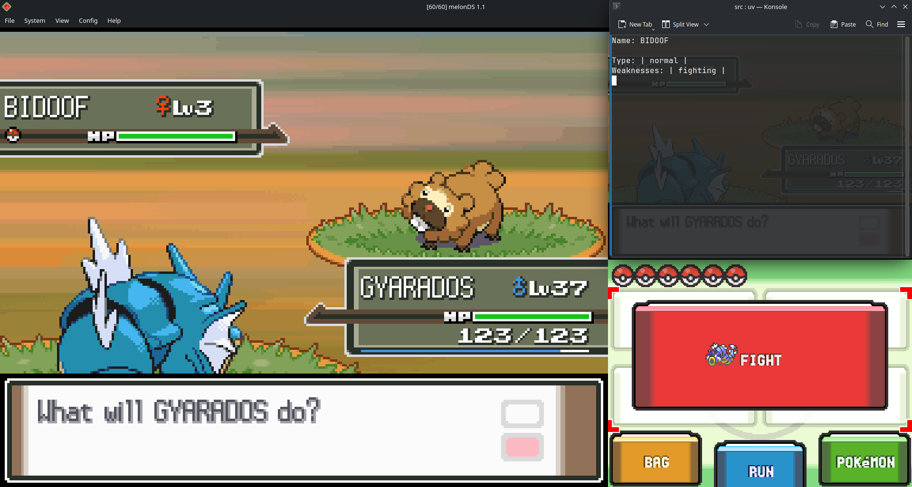

# Pokemon-Platinum-Fight-Assist

A Python command line tool which detects controller input and uses OCR and the PokéAPI
to return important information, such as: the Pokemon's type/s and weakness/es.
This tool was designed to prevent me from repetitively alt-tabbing to lookup
enemy weaknesses during a fight.


Screenshot of program running

Note: This tool only works with melonDS in Hybrid view on a single 1080p monitor. See Limitations for details.

## Features

- Detect controller input using PyGame
- Converts image to text using PyTesseract OCR
- Calls to the PokéAPI for information with requests
- Provides useful information for single/team battles

## Instructions

This program has only been tested by me on Fedora Linux - as such compatibility
guaranteed with other operating systems.

1. Run Pokemon Platinum
2. In the Melon DS topbar go to view > screen layour and select hybrid
3. Make sure you are in the game before running the program
4. During any fight press start on the controller

## Limitations

1. While other DS emulators may work, this program has only been tested with Melon DS.
2. The program uses screenshots in a pre-defined bounding box for OCR, as such:  
   2.1 MelonDS layouts other than hybrid will not work.  
   2.2 Compatibility with screen resolutions other than 1080P cannot be guaranteed.  
   2.3 The program may screenshot the incorrect monitor if multiple monitors are attatched.
3. The program uses hardcoded keybinds that were designed to only be compatible with the Xbox One controller.

## Running locally

```bash
git clone https://github.com/benlgw/pokemon-platinum-fight-assist.git
cd pokemon-platinum-fight-assist/
uv run main.py
```

## Disclaimer

This project is an unofficial fan tool with no affiliation with MelonDS or Nintendo.
In addition this is a tool made for personal use and as such no support will be
provided should issues occur.
